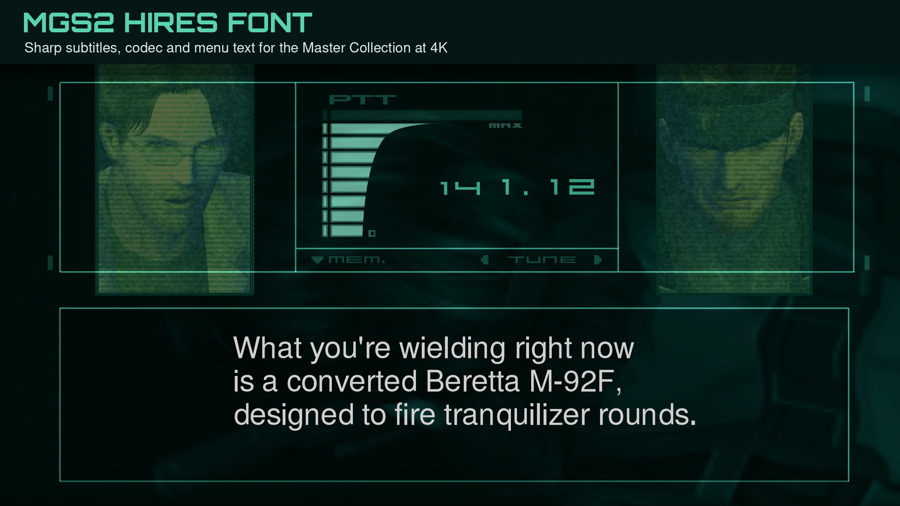
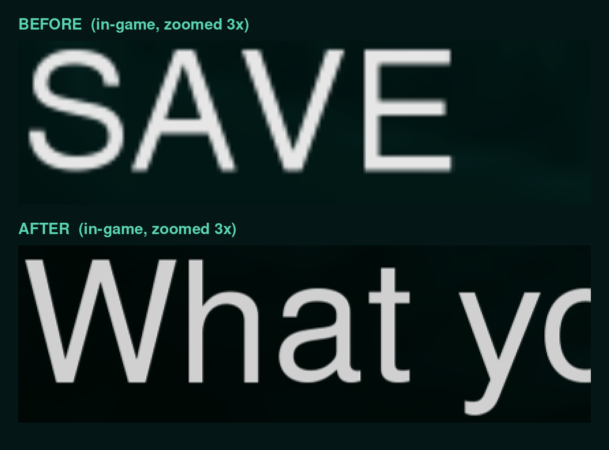

# MGS2 HiRes Font

Sharp subtitles, codec and menu text for **METAL GEAR SOLID 2: Sons of Liberty – Master Collection** (Steam).



The Master Collection draws all dialogue text (subtitles, codec conversations, save/load menus)
from a 40-pixel bitmap font and stretches it to your resolution. At 4K that is a 3x stretch, so
the text is soft. This plugin makes the game draw that text at 3x. Position, size, spacing and
line breaks are unchanged.



Status: **beta**. Tested at 4K on Linux (Proton), in English, on subtitles, codec dialogue and
the save/load list.

## Install

1. You need an ASI loader (Ultimate ASI Loader). MGSHDFix ships one.
2. Copy `MGS2HiResFont.asi` and `MGS2HiResFont.bin` into the game's `plugins` folder.

To remove it, delete `MGS2HiResFont.asi`.

The plugin never modifies the executable on disk. It checks the bytes of every function it
patches first, so on another game version it does nothing. It writes `MGS2HiResFont.log` next
to the `.asi`; attach it to bug reports.

## Not covered

- Japanese text and special symbols use the game's own glyphs, enlarged. They are no sharper.
- Area-name plates and the pixel-style HUD font are textures, not this font.

## How it works

The font is a gzip blob in the executable. The game rasterises it on the CPU into "text
surfaces" sized in font pixels and stretches those over a 1280x720 virtual screen, so a bigger
font alone would only draw bigger text. The plugin leaves the font and all layout alone and
supersamples inside the font module:

- the text-surface allocators create surfaces 3x larger;
- the lock function and the texture-size getters used by the menus report the original size;
- the glyph, half-size glyph and row-clear routines draw at 3x, from `MGS2HiResFont.bin`.

Surfaces created any other way, and glyphs missing from the `.bin`, go through the game's code.
The comments in `MGS2HiResFont.cpp` give the addresses and structures.

## Build

Needs MinGW-w64, Python 3 with Pillow and fontTools, and a Helvetica-like typeface.

```sh
./build.sh                                          # MGS2HiResFont.asi
python3 mgsfont.py "METAL GEAR SOLID2.exe" font_original.raw
python3 make_hires_font.py font_original.raw NimbusSans-Regular.otf MGS2HiResFont.bin
```

`font_original.raw` is game data: do not redistribute it. The `.bin` built as above contains
only glyphs drawn from the typeface, under that typeface's licence (Nimbus Sans is AGPL v3;
Liberation Sans is OFL).

Offline test of the drawing code, without the game (output is raw RGBA, 2520x372):

```sh
./build.sh test
wine test.exe font_original.raw MGS2HiResFont.bin "Snake, do you copy?" out.rgba
```
